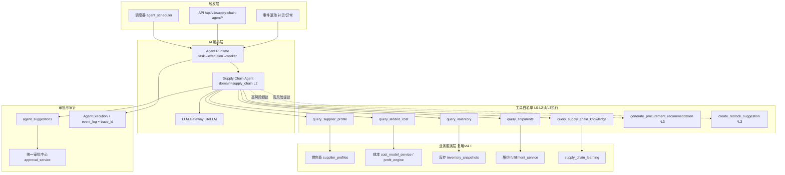
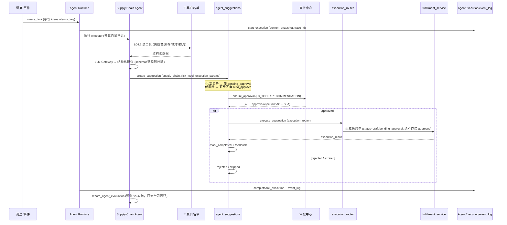

# M4.2 Supply Chain Agent — 架构设计（Architecture）

> 版本：v1.0
> 日期：2026-11-21
> 阶段：M4.2 第一阶段（现状审计 + 架构设计，不含代码实施）
> 决策身份：ChatGPT Owner
> 执行身份：DSH（执行 Agent）
> 上游依据：`M4.2_GAP_ANALYSIS.md`、`docs/project_architecture.md`、`docs/AGENTS.md`

---

## 1. 设计原则

M4.2 Supply Chain Agent 的架构遵循以下不可协商的原则（源自 `AGENTS.md` §3 与 Owner 指令）：

| # | 原则 | 落地方式 |
|---|---|---|
| P1 | **Agent 是提议者不是执行者** | 所有采购/补货/改价建议只写 `agent_suggestions`，高风险动作进审批队列，人工确认后才执行 |
| P2 | **全链路可审计** | 每次 Agent 运行（input/plan/tool_calls/output/cost/审批）落 `AgentExecution` + `event_log`，统一 `trace_id` |
| P3 | **白名单工具** | Agent 只能调用 `AgentTool` 注册表内的工具，经三层门禁（白名单 + 业务域 scope + L0-L3 权限） |
| P4 | **单一模型网关** | 所有 LLM 调用走 LiteLLM Gateway，按任务路由，配额 + 缓存 + 降级 |
| P5 | **不重复建设** | 复用 M4.1/M4.2 预研的表、服务、Agent 基础设施；GAP 分析中标记 ✅ 的一律复用 |
| P6 | **硬规则不可被 AI 修改** | 业务约束落 `rules` 表（`rule_type="hard"`），AI 只能 `check/evaluate/suggest` 读取评估；`override()` 只审计不执行 |
| P7 | **数据可信度** | 商品事实须有来源与证据等级；1688 未验证数据不得当真实成交价；预测成本 ≠ 实际成本 |
| P8 | **Docs Before Code** | 本设计文档集先于代码，经 Owner 审批后再实施 |

---

## 2. 在系统分层中的位置

M4.2 Supply Chain Agent 位于 `project_architecture.md` 的 **AI 编排层**，归属 `AgentRegistry.domain="supply_chain"`。它**不新增独立服务栈**，而是**编排已有的业务服务层能力**为「提议者」能力。

**关键点**：Supply Chain Agent（`SC`）只**读取**业务服务层数据（经 L0-L2 工具），**产出结构化建议**写 `agent_suggestions`；任何下单/补货执行类工具（`T6/T7`）定义为 **L3**，自动停在 `waiting_approval` 进审批中心，**结构上不可能自动执行**。

---

## 3. 架构债收口策略（对应 GAP §4 横切债）

M4.2 设计**不扩散**既有架构债，并明确收口或隔离边界。本轮只做设计决策，迁移/修复动作列入 `M4.2_IMPLEMENTATION_ROADMAP.md`。

| 债 | 收口策略 | 本轮动作 |
|---|---|---|
| **D-1 采购/履约双轨存储** | **DB 版 `purchase_orders`（`fulfillment_service` 范式）为唯一采购单真源**。M4.2 所有采购建议/决策只读写 DB 版。JSON 文件版（`purchase_order_service`/`overseas_warehouse`/`logistics_monitor`/`auto_inquiry`/`newton_cost_monitor`）标记为**遗留**，M4.2 不扩展、不依赖；迁移至 DB 列入路线图 | 设计决策，本轮不迁移 |
| **D-2 采购单三套状态机** | 以 M4.1 `purchase_orders.PO_STATUSES`（draft→pending_cost_confirmation→approved→ordered→partial_received→received / cancelled）为**唯一规范状态机**。`fulfillment.py`/`procurement_workbench.py` 的状态集标记 deprecated | 设计决策 |
| **D-3 库存/物流多体系** | Agent 工具**只对接** M4.1 `inventory_snapshots`/`shipment_records`（有审计、有 workspace）。`inventory.py`/`logistics.py` 服务层不作为 Agent 数据源 | 设计决策 |
| **D-4 事件/审计不一致** | M4.2 新增或触达的服务**强制** event_service + trace_id（沿用 `supply_chain_learning` 规范） | 设计约束 |
| **D-5 成本估算静默降级** | 沿用 `fulfillment_service` + `profit_engine` 规范：缺真实成本即冻结/降置信度，UNKNOWN 禁止高置信结论，禁止伪造 | 设计约束 |
| **D-6 created_by 缺失** | M4.2 新增表一律含 `created_by`；存量表补齐列入路线图 | 新表遵守 |
| **D-7 supply_chain_manager generic 路径** | **升级**：迁移提示词进 Prompt Registry（`AGENT_SUPPLY_CHAIN_MANAGER`）、绑 `AgentRegistry`、接自定义 executor、接工具白名单——而非与运行时并存 | 设计决策 |
| **D-8 原生 SQL 旁路 + 状态集不一致** | M4.2 不依赖 `supply_chain.py` 末尾 `/purchase-orders/stats`、`PATCH /status`；收口列入路线图 | 设计决策 |
| **D-9 procurement_service 利润 bug** | `profit_margin` 失效修复列入路线图；M4.2 采购建议优先级模型重新设计，不依赖该失效分支 | 设计决策 |

---

## 4. 五大能力 → 服务/表映射

| M4.2 能力方向 | 复用的服务层 | 复用/新增的数据表 | Agent 能力 |
|---|---|---|---|
| ① 供应商智能分析 | `supply_chain_learning`（评估/模式）、`auto_inquiry`（询价采集，需规范化） | `suppliers`+`supplier_profiles`（**新增** risk_score/confidence/版本字段）、`product_sourcing_candidates`（**新增** valid_until/阶梯价）、**新增** `supplier_quote_history` | 供应商风险评分卡、比价、替代推荐 |
| ② 采购成本智能核算 | `cost_model_service`、`profit_engine`、`fulfillment_service`（成本门） | `product_cost`（**新增** source/confidence/trace/created_by）、**新增** `cost_prediction_vs_actual`、`shipment_records`（**新增** 实际运费/关税金额） | 动态成本、成本波动监控、预测vs实际对账 |
| ③ 采购决策辅助 | `purchase_automation_service`（异常检测）、`sourcing_evaluation_service`（评测） | **新增** `procurement_decisions`（结构化决策记录）、`inventory_snapshots`（**新增** reorder_point/safety_stock）、**新增** `demand_forecasts` | 需求预测→采购量、再订货点、多供应商比价决策 |
| ④ 库存与履约预测 | `fulfillment_service`、`inventory_sync_service`、`logistics_monitor_service`（升级为预测） | **新增** `inventory_movements`（append-only）、`shipment_records`（**新增** 承诺交期）、`stockout_events` | 需求预测、安全库存、缺货/延误风险预测、海外仓切换测算 |
| ⑤ 供应链学习闭环 | `supply_chain_learning`（**直接扩展**） | `supply_chain_calibration_runs`（扩展到成本/库存）、`supplier_profiles`（**新增** last_calibrated_at/model_version） | 学习闭环向成本/库存/需求扩展、校准回写链、线上抽样复核 |

---

## 5. 数据流：提议 → 审批 → 执行（核心治理链）

以「补货建议」为例，展示 M4.2 治理链（对应 AGENTS.md §3.3 人审与降级）：

**治理铁律在此链路的体现**：
1. **采购单永不直接 approved**——`fulfillment_service` 生成的是 `draft`/`pending_approval`，须经成本确认门（`confirm_purchase_order_cost`）+ 人工 approve。GAP D-1 指出的 `procurement_service.create_purchase_order` 直建 approved **在 M4.2 链路中被禁止使用**。
2. **中/高风险建议在调用审核 LLM 前就被拦下**保持 `pending_approval`（`AUTO_APPROVE_RISK_LEVELS` 默认仅 `low`）。
3. **生成 Agent ≠ 审核 Agent**（`supply_chain → business_analyst` 互审）。
4. **审批过期永不执行**（`approval_sla` → expired，绝不自动批准）。

---

## 6. LLM Gateway 与成本护栏

- 所有 LLM 调用经 LiteLLM Gateway（P4），按任务类型路由模型，配置配额与降级。
- **预算硬门禁**：`agent_budget.check_budget()` 在每次执行 attempt 前调用，投影成本超 `monthly_budget` 则 `allowed=False`，任务记 `ATTEMPT_BUDGET_BLOCKED`、发 `agent.execution_budget_blocked` 事件。Supply Chain Agent 须配置 `AgentBudgetPolicy`（monthly_budget / max_cost_per_execution / alert_threshold）。
- **降级链**：LLM 不可用 → 规则引擎 → 人工。供应链场景必须保证「回复不了也比乱建议强」——LLM 失败时 Agent 不得产出伪造建议。

---

## 7. 与现有 Agent 的关系

| 现有 Agent/路径 | M4.2 关系 |
|---|---|
| **Product Analyst**（pilot 路径，L2，只提案） | **对齐模板**。Supply Chain Agent 复刻其 seed→prompt→pilot→executor→评测→知识 全链路结构 |
| **`supply_chain_manager.py`**（generic 路径） | **升级对象**。迁移到运行时路径（见 D-7），复用其领域逻辑但接入版本化/白名单/审计 |
| **B2B 建议型 Agent**（Sales/Quotation/Collection，已接统一审批中心） | **参照**。供应链建议同样接入统一审批中心，复用 RBAC/SLA |

---

## 8. 不在本架构范围内（明确排除）

为防止范围膨胀与越权，以下**明确排除**在 M4.2 之外（与 Owner 指令一致）：

- ❌ 生产环境配置变更、支付、GA4、B2B 对外获客、凭据变更。
- ❌ AI 自行向供应商下单（任何外发采购执行）。
- ❌ AI 自行修改硬性业务规则（`rules` 表变更走版本化 + 人工）。
- ❌ 自动发布未经审核的商品。
- ❌ 海外仓真实 3PL 对接（属 M5）。
- ❌ B2B 规模化（属 M6）。

---

## 9. 架构决策记录（ADR 指针）

本设计涉及的关键决策建议在实施阶段沉淀为 ADR（`docs/business_decisions/ADR/`）：

| 建议编号 | 决策 |
|---|---|
| `SUPPLY-001` | 采购单唯一真源 = DB 版 `purchase_orders`，JSON 文件版废弃（收口 D-1） |
| `SUPPLY-002` | 采购单唯一规范状态机 = M4.1 `PO_STATUSES`（收口 D-2） |
| `SUPPLY-003` | Supply Chain Agent 权限 = L2（分析+提案），下单/补货执行工具 = L3（强制审批） |
| `SUPPLY-004` | 学习闭环复用 `supply_chain_learning` 骨架，向成本/库存/需求扩展 |

---

> **本阶段停止点**：本架构设计经 Owner 审批后，才进入 API/数据模型/规则的详细设计与实施规划。**不得自行进入代码实施**。
