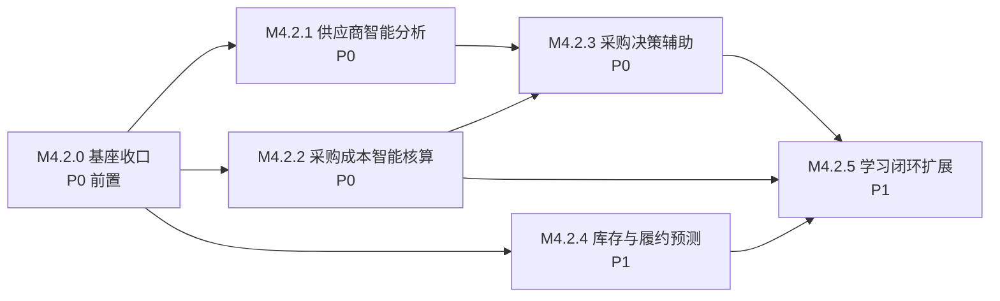

# M4.2 Supply Chain Agent — 实施路线图（Implementation Roadmap）

> 版本：v1.0
> 日期：2026-11-21
> 阶段：M4.2 第一阶段（现状审计 + 架构设计，不含代码实施）
> 决策身份：ChatGPT Owner
> 执行身份：DSH（执行 Agent）
> 上游依据：`M4.2_GAP_ANALYSIS.md`、`M4.2_ARCHITECTURE.md`、`docs/AGENTS.md` §1.3
> 工作流：分支 → 提交 → PR → 自检 → squash 合并（Conventional Commits）

---

## 1. 路线图总原则

| # | 原则 | 落地 |
|---|---|---|
| RD-1 | **Docs Before Code** | 本设计文档集（9 份）先经 Owner 审批，**之后**才进入代码实施 |
| RD-2 | **先收口后扩展** | 先治理架构债（采购单范式统一、事件审计补齐），再叠加新能力——避免在分裂地基上盖楼 |
| RD-3 | **最小闭环优先** | 每个子阶段交付可验证的垂直切片，不铺大摊子（AGENTS.md §1.2） |
| RD-4 | **人审在环** | 每个涉及执行的能力先接审批队列，再考虑自动化 |
| RD-5 | **评测先行** | 新能力上线前先有评测集（≥20 用例），无评测不上线 |
| RD-6 | **每个里程碑独立 PR** | 每个子阶段独立分支 + PR，CI 全绿才合并 |
| RD-7 | **本轮不实施** | 本路线图是**计划**；所有编码/迁移/种子任务待 Owner 审批本设计文档后启动 |

---

## 2. 子阶段划分（对齐五大方向优先级）

Owner 已定优先级：M4.2.1 供应商智能分析（P0）、M4.2.2 采购成本智能核算（P0）、M4.2.3 采购决策辅助（P0）、M4.2.4 库存与履约预测（P1）、M4.2.5 供应链学习闭环（P1）。

> **重要前置**：M4.2.1 之前须先完成 **M4.2.0 基座收口**（架构债治理），否则新能力建在分裂地基上。

### 阶段依赖图

---

## 3. M4.2.0 — 基座收口（P0 前置，强烈建议先行）

**目标**：治理阻塞性架构债，为 Supply Chain Agent 建立干净地基。

| 任务 | 对应债 | 验收标准 |
|---|---|---|
| **T0.1 注册 Supply Chain Agent 骨架** | D-7 | `ensure_supply_chain_analyst_agent()` 播种 + `AGENT_SUPPLY_CHAIN_ANALYST` 提示词入 Prompt Registry + `AgentRegistry(permission_level=L2)`；`supply_chain_manager` generic 路径标记 deprecated |
| **T0.2 统一采购单范式** | D-1/D-2 | 明确 DB 版 `purchase_orders`（`fulfillment_service` 范式）为唯一真源；JSON 版标记遗留；**封堵** `procurement_service.create_purchase_order` 直建 approved 漏洞（改为走审批/draft） |
| **T0.3 补齐事件审计** | D-4 | `fulfillment_service`/`purchase_automation_service`/`procurement_service` 补 event_service + trace_id（对齐 supply_chain_learning 规范） |
| **T0.4 修复已知 bug** | D-9 | `procurement_service.generate_procurement_suggestions` 的 `profit_margin` 失效修复 |
| **T0.5 迁移基础数据模型** | D-6 + §2 数据模型 | Alembic 迁移：`supplier_profiles`（risk_score 等）、`product_cost`（source/confidence）、`purchase_orders`（approved_by）、`inventory_snapshots`（reorder_point 等）、`shipment_records`（实际成本/承诺交期） |
| **T0.6 基座测试** | — | 迁移往返测试 + 封堵漏洞的负向测试 + 事件审计断言；CI 全绿 |

**验收**：采购单唯一范式确立、治理漏洞封堵、事件审计补齐、基础迁移落地、CI 绿。

**工作量估算**：中等（多为收口与补齐，非新建）。

---

## 4. M4.2.1 — 供应商智能分析（P0）

**目标**：供应商风险量化 + 比价 + 替代推荐。

| 任务 | 验收标准 |
|---|---|
| T1.1 `supplier_quote_history` 表 + 迁移 | 报价历史（有效期/阶梯价/付款条件）append-only |
| T1.2 供应商风险评分卡服务 | 聚合画像+评估+模式+报价 → risk_score/confidence/组件/证据 |
| T1.3 供应商比价服务 | 多候选横向比较（landed_cost/risk/MOQ/交期） |
| T1.4 API：risk-scorecard + supplier-comparison | 规范 endpoint（schema/response_model/审计/trace） |
| T1.5 供应商读类工具（L1） | `query_supplier_profile`/`query_sourcing_candidates` 入白名单 |
| T1.6 评测用例（≥4） | 评分卡/比价正负边界 |
| T1.7 单测 + 集成测试 | 覆盖率 ≥80%（核心域） |

**验收**：能产出供应商风险评分卡与比价建议，经 API 可查，评测通过。

---

## 5. M4.2.2 — 采购成本智能核算（P0）

**目标**：成本证据化 + 预测 vs 实际对账 + 价格监控。

| 任务 | 验收标准 |
|---|---|
| T2.1 `cost_prediction_vs_actual` 表 + 迁移 | 成本预测 vs 实际对账实体 |
| T2.2 实际成本回灌服务 | shipment 实际运费/关税回灌校准 landed cost |
| T2.3 成本波动监控 | 采购价格变化监控 + 告警（软） |
| T2.4 硬规则入库 | `SC_NO_UNVERIFIED_COST`/`SC_COST_CEILING`/`SC_COST_CONFIRMATION_REQUIRED` |
| T2.5 API：landed-cost + cost-variance | UNKNOWN 降级、置信度分级 |
| T2.6 成本读类工具（L1） | `query_landed_cost` 入白名单 |
| T2.7 评测用例（≥4） | 含 UNKNOWN/1688 未验证边界 |

**验收**：成本核算证据化、预测 vs 实际可对账、未验证数据被门控。

---

## 6. M4.2.3 — 采购决策辅助（P0，核心）

**目标**：需求预测 → 采购量 → 结构化决策 → 人审闭环（**不含自动下单**）。

| 任务 | 验收标准 |
|---|---|
| T3.1 `demand_forecasts` 表 + 预测服务 | 需求预测（真实销量数据，数据不足降级不伪造） |
| T3.2 `procurement_decisions` 表 + 决策服务 | 结构化采购决策记录（推荐供应商/量/目标价/MOQ/预期到货/理由/规则快照） |
| T3.3 再订货点/安全库存计算 | 基于需求预测 + 库存 |
| T3.4 硬规则入库 | `SC_MIN_ORDER_QTY`/`SC_SAFETY_STOCK_RESPECT`/`SC_NO_AUTO_PURCHASE`/`SC_NO_RULE_AUTO_MODIFY` |
| T3.5 审批闭环 API | procurement-decisions approve/reject（RBAC + 防双审） |
| T3.6 L3 提议工具 | `generate_procurement_recommendation`（强制审批，**不外发下单**） |
| T3.7 采购单联动 | 经 fulfillment_service 生成 draft/pending_approval，**永不直接 approved** |
| T3.8 评测用例（≥5） | 含 MOQ/成本上限/安全库存 gate + 永不自动下单负向 |

**验收**：能产出结构化采购建议、经人审、生成内部采购单走规范状态机、**全程无自动外发下单**。

---

## 7. M4.2.4 — 库存与履约预测（P1）

**目标**：库存历史序列 + 缺货/履约风险预测。

| 任务 | 验收标准 |
|---|---|
| T4.1 `inventory_movements` + `stockout_events` 表 | append-only 库存变动 + 缺货事件 |
| T4.2 库存变动记录服务 | inbound/outbound/reserve 记录 append-only |
| T4.3 缺货/延误风险预测 | 基于库存历史 + 需求预测 + 物流时效 |
| T4.4 承诺交期 vs 实际对账 | shipment promised vs delivered |
| T4.5 API：demand-forecast + reorder + movements + stockout-events | 规范 endpoint |
| T4.6 库存读类工具（L1） | `query_inventory`/`query_shipments` 入白名单 |
| T4.7 评测用例（≥4） | 含数据不足降级边界 |
| T4.8 （可选）海外仓切换测算 | 中国直发 vs 海外仓对比 |

**验收**：库存历史可追溯、缺货风险可预测、再订货建议可用。

---

## 8. M4.2.5 — 学习闭环扩展（P1）

**目标**：学习闭环向成本/库存/需求扩展 + 校准回写链 + 线上抽样复核。

| 任务 | 验收标准 |
|---|---|
| T5.1 成本维度接入学习闭环 | `cost_prediction_vs_actual` 接入评估/模式；`price_pattern` 补 suggested_params |
| T5.2 库存/需求维度接入 | 需求预测/缺货预测准确率纳入 AgentEvaluation |
| T5.3 校准回写链 | approve 后经版本化（StrategyVersion/规则版本）**人工确认**回写 rules/profiles，留审计 |
| T5.4 profile 回写追溯 | risk_score_* + last_calibrated_at + model_version + source_trace_id |
| T5.5 线上抽样复核 | 抽样 → 人工复核 → human_rating → 回流评测集 |
| T5.6 Agent 评测集（≥20） | 覆盖五大方向，固定 fixture |
| T5.7 全链路回归 | 提示词/模型变更跑评测回归 |

**验收**：学习闭环覆盖成本/库存/需求、校准仅提议+人工回写、评测集 ≥20、回归通过。

---

## 9. 架构债收口排期（D-1…D-9）

| 债 | 收口阶段 | 方式 |
|---|---|---|
| D-1 采购/履约双轨存储 | **M4.2.0 T0.2**（封堵漏洞）+ 后续迁移 | M4.2.0 确立 DB 唯一真源 + 封堵直建 approved；JSON 版→DB 迁移分批（非阻塞，列入 Backlog `TODO(tech-debt)`） |
| D-2 三套状态机 | M4.2.0 T0.2 | 确立 M4.1 `PO_STATUSES` 唯一规范；其余 deprecated |
| D-3 库存/物流多体系 | M4.2.0（设计约束） | Agent 只对接 M4.1 规范表；技术债 router 迁移列入 Backlog |
| D-4 事件审计不一致 | M4.2.0 T0.3 | 补齐 event_service + trace_id |
| D-5 成本估算静默降级 | M4.2.2（设计约束） | 沿用 fulfillment_service 规范 |
| D-6 created_by 缺失 | M4.2.0 T0.5（新表）+ 后续 | 新表含 created_by；存量表分批补 |
| D-7 supply_chain_manager generic | **M4.2.0 T0.1** | 升级到运行时路径 |
| D-8 原生 SQL 旁路 + 状态集不一致 | 收口列入 Backlog | M4.2 不依赖；标记 `TODO(tech-debt)` |
| D-9 profit_margin bug | **M4.2.0 T0.4** | 修复 |

---

## 10. 推荐的首个开发任务（M4.2.0 → M4.2.1）

**Owner 问：推荐的 M4.2.1 首个开发任务是什么？**

**推荐：从 M4.2.0「T0.1 注册 Supply Chain Agent 骨架 + T0.2 统一采购单范式（封堵治理漏洞）」开始。**

理由：
1. **T0.1** 让 Supply Chain Agent「存在」于运行时（注册 + 提示词版本化 + 权限 L2），是后续一切能力的载体——**最小可行闭环**。
2. **T0.2** 封堵 `procurement_service.create_purchase_order` 直建 approved 的**治理漏洞**（违反「AI 不得自行下单」约束的最高优先级安全问题），并确立采购单唯一范式——**安全优先**。
3. 这两项**工作量小、风险低、依赖少**，能快速验证整条 Agent 运行时链路（注册→任务→执行→审计），为 M4.2.1 业务能力打地基。

**紧随其后**：T0.3 补事件审计 + T0.5 基础迁移，然后进入 M4.2.1 供应商智能分析。

---

## 11. 工作量与排期总览

| 阶段 | 优先级 | 相对工作量 | 关键依赖 |
|---|---|---|---|
| M4.2.0 基座收口 | P0 前置 | 中（收口+补齐） | 无（先行） |
| M4.2.1 供应商智能 | P0 | 中 | M4.2.0 |
| M4.2.2 成本核算 | P0 | 中 | M4.2.0 |
| M4.2.3 采购决策 | P0 核心 | 大（预测+决策+审批闭环） | M4.2.1 + M4.2.2 |
| M4.2.4 库存履约预测 | P1 | 中大（预测模型） | M4.2.0 |
| M4.2.5 学习闭环扩展 | P1 | 中 | M4.2.2/3/4 |

> 具体日历排期由 Owner 根据资源确定；本路线图给出**顺序、依赖、验收标准**。P0 三阶段（0/1/2/3）建议优先完成，形成「供应商→成本→采购决策」的采购决策辅助最小闭环。

---

## 12. 每个阶段的 PR 与门禁

| 项 | 要求 |
|---|---|
| 分支命名 | `feat/m4-2-<阶段>-<简述>` |
| 提交信息 | Conventional Commits（`feat(supply_chain): ...`） |
| PR | 每子阶段独立 PR；描述含设计文档引用 + 验收标准核对 |
| 门禁 | lint（F821/F811/E9 阻塞）+ 单测 + 集成测试 + pip-audit 全绿（AGENTS.md §2.5） |
| 覆盖率 | 核心域 ≥80% |
| 文档同步 | 改动架构/流程同步 `/docs` 并升版本号 |
| 审计/回滚 | 每阶段具备审计 + 回滚能力（Alembic downgrade + 规则版本回滚） |

---

## 13. 不在本路线图范围（明确排除）

- ❌ 生产环境配置变更、支付、GA4、B2B 对外获客、凭据变更。
- ❌ AI 自动向供应商外发下单（任何阶段都不做）。
- ❌ AI 自行修改硬规则（任何阶段都不做）。
- ❌ 海外仓真实 3PL 对接（M5）。
- ❌ B2B 规模化（M6）。
- ❌ D8-E 遗留安全事项的删除/降级（始终保留）。

---

> **本阶段停止点**：本路线图经 Owner 审批后，按 M4.2.0 → M4.2.1 顺序启动实施。**当前不实施任何代码任务。**
